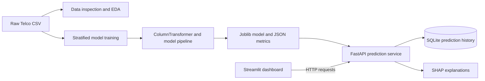

# ChurnGuard

ChurnGuard is a local customer churn analysis and prediction application. It
inspects a Telco churn CSV, compares three classifiers using a leakage-safe
preprocessing pipeline, exposes the selected model through FastAPI, records
predictions in SQLite, and provides a Streamlit dashboard. It is an educational
decision-support prototype, not an automated customer-decision system.

## Dataset and approved schema mapping

The supplied file is `Data/Raw/Copy of Telco_customer_churn.csv` (7,043 rows,
33 columns). Its target is `Churn Label` (`Yes`/`No`) and its billing column is
`Total Charges`; it does not use the canonical `Churn` / `TotalCharges` names.
The user explicitly approved mapping `Churn Label` to the binary model target
and converting `Total Charges` to numeric. The raw CSV is not modified.

Observed target counts are 5,174 `No` and 1,869 `Yes` (26.54% positive). There
are no fully duplicated rows. `Total Charges` has 11 blank values; they are
imputed inside the training pipeline. `Churn Reason` is blank for 5,174 rows,
as it describes post-outcome churn. `Churn Value` duplicates the target.

The following fields are excluded from predictors:

| Field(s) | Reason |
|---|---|
| `CustomerID` | Unique customer identifier |
| `Churn Value` | Duplicate target encoding |
| `Churn Score` | Outcome-related score with leakage risk |
| `Churn Reason` | Post-outcome information |
| `CLTV` | Potential outcome-derived information; excluded pending provenance review |
| `Country`, `State`, `City`, `Zip Code`, `Lat Long`, `Latitude`, `Longitude` | Location-related privacy and generalization risk |
| `Count` | Dataset row-count field, not a customer attribute |
| Any constant field | No predictive variation |

These choices, plus the selected target and input schema, are recorded in
`models/metadata.json` when training runs.

## Architecture



The API loads the saved model; it never retrains while serving requests. The
dashboard does not load or invoke the model directly.

## Stack and layout

- Python 3.13 was used for validation (3.11+ is intended).
- pandas, NumPy, Matplotlib, Seaborn
- Scikit-learn, XGBoost, SHAP, Joblib
- FastAPI, Pydantic, Uvicorn
- SQLAlchemy with SQLite
- Streamlit, Plotly, Requests
- Pytest and HTTPX

```text
Data/Raw/                     Original CSV (read-only to this application)
artifacts/eda/                Data profile and descriptive charts
artifacts/training/           Evaluation plots and training metrics
api/                          REST routes, schemas, history database, services
dashboard/app.py              Streamlit UI; API client only
models/                       Trained artifact, metadata, measured metrics
src/                          Validation, preprocessing, training, prediction
tests/                        Deterministic synthetic-data tests
notebooks/01_eda.ipynb         EDA walkthrough using the reproducible inspection script
```

## Setup

From the project root in Windows PowerShell:

```powershell
python3 -m venv .venv
.\.venv\Scripts\Activate.ps1
python -m pip install --upgrade pip
python -m pip install -r requirements.txt
if (-not (Test-Path .env)) { Copy-Item .env.example .env }
```

If your Python launcher is `py`, create the environment with
`py -3.13 -m venv .venv`. In a POSIX shell, use `python3 -m venv .venv`,
`source .venv/bin/activate`, and `python -m pip install -r requirements.txt`.
All dependencies are pinned and were installed successfully with Python 3.13.14.

Keep the supplied CSV in `Data/Raw/`. The inspection and training commands
require exactly one CSV there. For an alternate input, pass `--csv-path
PATH_TO_FILE`; do not overwrite the raw dataset.

## Inspect data (Phase 1)

```powershell
python -m src.inspect_data
```

The command computes dimensions, data types, missingness, duplicate rows,
target counts and percentages, category summaries, and descriptive segment
rates. It writes `artifacts/eda/data_profile.json` and charts for label
distribution, churn by contract, tenure, monthly charges, payment method, and
numeric-feature correlations. Charts describe associations, not causes.
High-cardinality category values are summarized rather than dumped into the
report.

## Train and evaluate (Phase 2)

```powershell
python -m src.train
```

Optional flags: `--csv-path PATH`, `--artifact-path PATH`, `--threshold 0.5`,
and `--seed 42`. The default run uses stratified 60/20/20 train, validation,
and held-out test splits. Imputation, scaling, and one-hot encoding are fitted
only on the training split. Unknown categorical values are ignored by the
encoder rather than causing inference to fail.

Logistic Regression, Random Forest, and XGBoost are compared on validation
ROC-AUC; the test split is used only for the final selected model evaluation.
Threshold 0.5 is the default display/classification rule, not a universal
business decision. The run writes:

- `models/churnguard.joblib`: fitted pipeline, metadata, metrics, SHAP background
- `models/metadata.json`: model version, split, schema, feature names and exclusions
- `models/metrics.json`: validation comparison and held-out test metrics
- `artifacts/training/`: ROC, precision-recall, confusion matrix, feature-importance plots

### Measured run in this workspace

The completed default run selected **Logistic Regression** using validation
ROC-AUC. Measured validation ROC-AUC was **0.8660**. On the held-out 20% test
split (1,409 rows), ROC-AUC was **0.8453**, PR-AUC (average precision)
**0.6515**, precision
**0.5171**, recall **0.8075**, F1 **0.6305**, and accuracy **0.7488** at the
0.5 threshold. Confusion matrix (actual rows: no churn, churn; predicted
columns: no churn, churn): `[[753, 282], [72, 302]]`.

These values are measured for the current dataset, split seed, and dependency
versions; they are not deployment guarantees. Precision, recall, calibration,
threshold utility, and subgroup performance need business review and further
validation.

## Run the API

Start from the repository root in a dedicated terminal:

```powershell
python -m uvicorn api.main:app --reload
```

The API loads `models/churnguard.joblib` at startup. Without the artifact,
`/health` reports model unavailability and prediction routes return HTTP 503.
Swagger UI is available at `http://127.0.0.1:8000/docs`.

| Endpoint | Purpose |
|---|---|
| `GET /health` | Model and history readiness |
| `GET /model/info` | Model version and training metadata |
| `GET /metrics` | Actual validation comparison and test metrics |
| `GET /features` | Required input feature schema and category choices |
| `POST /predict` | Single probability, class, risk, SHAP, suggestions |
| `POST /predict/batch` | Batch predictions (default cap: 500) |
| `GET /history?limit=50&offset=0` | Paginated history |
| `GET /history/{prediction_id}` | One saved record |
| `GET /analytics/summary` | Safe aggregates of prediction history |
| `GET /analytics/training` | Descriptive source-data profile |

Example single request:

```json
{
  "customer_label": "example",
  "features": {
    "Gender": "Female",
    "Senior Citizen": "No",
    "Partner": "Yes",
    "Dependents": "No",
    "Tenure Months": 12,
    "Phone Service": "Yes",
    "Multiple Lines": "No",
    "Internet Service": "DSL",
    "Online Security": "No",
    "Online Backup": "Yes",
    "Device Protection": "No",
    "Tech Support": "No",
    "Streaming TV": "No",
    "Streaming Movies": "No",
    "Contract": "Month-to-month",
    "Paperless Billing": "Yes",
    "Payment Method": "Electronic check",
    "Monthly Charges": 65.0,
    "Total Charges": 780.0
  }
}
```

Use `GET /features` as the authoritative schema for the currently trained model.
The API rejects missing, unexpected, target, identifier, and excluded features.
Unknown categorical values are accepted and handled by the fitted encoder.

## Run the dashboard

Keep the API running; start Streamlit from the repository root in another
terminal:

```powershell
streamlit run dashboard/app.py
```

The dashboard supports overview metrics and history, dynamic single-customer
forms, CSV batch validation and export, model performance, descriptive churn
segments, and a model-card summary. Configure `BACKEND_URL` in `.env` if the
API is not at its default local address. CSV uploads are read in memory and are
not overwritten. The dashboard calls the backend over HTTP; it does not make
predictions independently.

## Prediction history and configuration

The default database URL is `sqlite:///./artifacts/churnguard.db`. History
stores UTC timestamp, optional display label, probability, class, risk band,
threshold, model version, and the exact validated predictor attributes. Those
attributes are stored so a local reviewer can inspect the prediction context;
the prototype does not enforce access control. Do not store real customer data
without a privacy, access-control,
retention, and security plan.

`.env.example` lists non-secret defaults:

- `MODEL_ARTIFACT_PATH`
- `DATABASE_URL`
- `BACKEND_URL`
- `MAX_BATCH_SIZE`
- `DECISION_THRESHOLD`

The model's threshold is saved at training time. Change it with the training
command's `--threshold` option and retrain deliberately; do not imply it has
been optimized for business value.

## Tests

```powershell
python -m pytest -q
```

Tests use deterministic synthetic records and do not require production
customer data. The training-artifact test fits only Logistic Regression to
keep the suite small; the CLI training command compares all three model types.

## Troubleshooting

- **Model not ready:** run `python -m src.train`, then restart Uvicorn.
- **CSV not found / multiple CSVs:** place one source CSV in `Data/Raw/` or
  supply `--csv-path`.
- **Missing/extra prediction fields:** use the exact current schema from
  `/features`; the target is never an input.
- **Dashboard cannot reach API:** verify Uvicorn is running and `BACKEND_URL`
  matches its host and port.
- **History unavailable:** check the configured SQLite path is writable. Single
  predictions can still run; the API returns a history warning.
- **SHAP unavailable:** the prediction response includes an explicit
  explanation warning; do not treat missing attribution as an explanation.

## Limitations, ethics, and deployment

This dataset is historical and may not reflect current customers or business
conditions. Historical relationships can encode bias. Predictions are not
causal statements; SHAP is model attribution, not proof of why a customer will
leave. Retention suggestions are transparent review prompts, not evidence that
an intervention will prevent churn. Human review is required, and model output
must not automatically alter service or price.

Before real deployment, assess licensing and data provenance, representative
validation, calibration, subgroup performance, drift, cost-sensitive threshold
choice, fairness, privacy, access control, encryption, audit logging, database
retention/deletion, secrets handling, and operational monitoring. The local
prototype is **not production-secure** and has no authentication, authorization,
TLS, or rate limiting. Docker support is intentionally omitted because local
artifact/data mounting and model-training lifecycle have not been packaged as
a tested deployment image.

See [MODEL_CARD.md](./MODEL_CARD.md) for intended use, provenance, limitations,
and privacy considerations.
